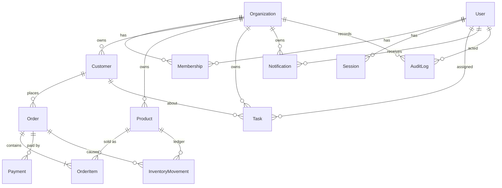

# PULSE architecture

## 1. Product summary

**Users.** Owners and teams of small product businesses: shops, studios, wholesalers.

**Jobs.**
- Know what's in stock and never sell what isn't there.
- Take an order from draft to delivered.
- Know who owes money, and send customers an invoice for it.
- Keep the team's follow-ups in one place.
- See how the business is doing, from real data.

Each **organization** is a tenant. A user can belong to several organizations, with a role in each.

| Role | Intent |
|---|---|
| Owner | Full control, including other owners. Every organization keeps at least one. |
| Admin | Settings, members below admin, refunds, full audit log |
| Manager | Operations: products, stock adjustments, cancellations, recording payments, analytics, assigning tasks |
| Staff | Day-to-day: customers, orders (create, confirm, fulfil), their own tasks |

The full permission matrix lives in [`packages/shared/src/permissions.ts`](../packages/shared/src/permissions.ts). The API enforces it on every route, and the Team page renders the same matrix.

## 2. Request flow

```
Browser ──► nginx / Vite proxy ──► Express
                                    helmet · CORS · JSON (100kb) · cookie-parser · pino-http
                                    /api ─► rate limit ─► CSRF guard ─► loadSession
                                           /auth/*            (public + session routes)
                                           tenant router ─► requireAuth ─► requireOrg ─► requirePermission(p)
                                                             ─► routes (parse with Zod) ─► service (rules, transaction) ─► Prisma ─► Postgres
                                    errorHandler (AppError / Zod / Prisma → safe JSON)
```

- **Routes** parse input with the shared Zod schemas and call one service function. They contain no business logic.
- **Services** own the business rules and transactions. Every query is scoped by `ctx.organizationId`.
- **`requireOrg`** reloads the membership and role from the database on every request. Role changes and removals take effect immediately, even with an existing session.

## 3. Data model



### Key design decisions

- **The database enforces tenant isolation.** Child records reference parents through composite `(id, organizationId)` foreign keys. For example, `Order(customerId, organizationId) → Customer(id, organizationId)`, so an order can't point at another tenant's customer even if application code has a bug.
- **Money is stored as integer cents.** One currency per organization. Tax is in basis points and rounds half-up after discount (`calculateOrderTotals` in shared).
- **Stock has two counters.** `onHand` is physical stock and `reserved` is held by confirmed orders. Available stock is `onHand − reserved`. CHECK constraints enforce `0 ≤ reserved ≤ onHand`.
- **Order items snapshot** the product name, SKU and unit price, so catalog edits never rewrite history. A CHECK enforces `lineTotal = unitPrice × quantity`.
- **Payment balances.** `Order.paidCents` and `Order.refundedCents` are updated in the same transaction as each `Payment` row, under the order's row lock. CHECKs prevent refunds exceeding payments and net payments exceeding the total. A test asserts the counters equal the sum of the payment rows. Payment status and outstanding balance are derived and never stored.
- **Append-only history.** A trigger rejects UPDATE and DELETE on `AuditLog`, and UPDATE on `InventoryMovement`.
- **Soft archive over delete.** Customers and products that have orders can only be archived. Deleting is allowed only when there's no history.

## 4. Business rules

### Order lifecycle

```
DRAFT ──confirm──► CONFIRMED ──fulfil──► FULFILLED ──complete──► COMPLETED
  │                    │
  └──cancel──► CANCELLED ◄──cancel──┘
```

| Transition | Effect on stock | Who |
|---|---|---|
| Confirm | `reserved += qty` for each item, all-or-nothing; fails with 422 `INSUFFICIENT_STOCK` | orders:write |
| Fulfil | `onHand −= qty`, `reserved −= qty` | orders:write |
| Complete | none. Requires `FULFILLED`. An unpaid balance stays as a receivable. | orders:write |
| Cancel (draft) | none | orders:cancel |
| Cancel (confirmed) | `reserved −= qty` (released) | orders:cancel |

- Any other transition returns 409 `INVALID_TRANSITION`.
- Only drafts can be edited. Edits re-price items from the current catalog.
- Order numbers are sequential per organization, using an atomic increment.

**Decision on completion and payment:** completing an order requires fulfilment, not full payment. Businesses that ship on credit can close the order while the balance stays visible as a receivable (receivables aging, "delivered but unpaid" alerts).

### Payments

- Payments are allowed only on confirmed, fulfilled or completed orders. Refunds are allowed on any order with money collected, including after cancellation.
- `amount ≤ outstanding` for payments and `amount ≤ collected − refunded` for refunds. Both are checked while holding the order's row lock.
- **Idempotency.** The client sends `idempotencyKey`, with a unique index on `(organizationId, idempotencyKey)`. Retrying the same request returns the original payment with status 200. Reusing a key for a different payment returns 409. A concurrent race is settled by the unique index.
- A second payment with the same `reference` on the same order is rejected as a likely duplicate.
- PULSE records payments. It never talks to a payment gateway.

### Inventory and concurrency

Every stock change goes through one function, `applyStockChange` in `apps/api/src/modules/inventory/stock.ts`, which runs a single guarded statement:

```sql
UPDATE "Product" SET "onHand" = "onHand" + $dOn, "reserved" = "reserved" + $dRes
WHERE id = $id AND "organizationId" = $org
  AND "onHand" + $dOn >= 0 AND "reserved" + $dRes >= 0
  AND "onHand" + $dOn >= "reserved" + $dRes
RETURNING ...
```

Postgres takes a row lock and re-evaluates the WHERE clause against the latest committed row. Two orders racing for the last unit therefore can't both succeed, and no application-level locking is needed.

- Multi-product changes are applied in sorted product-id order to avoid deadlocks.
- Each change writes an `InventoryMovement` row in the same transaction.
- State transitions and payments first take `SELECT … FOR UPDATE` on the order, which serializes double-submits.
- When available stock crosses below its threshold, a single `LOW_STOCK` notification goes to owners, admins and managers.

Covered by `apps/api/test/concurrency.test.ts`:
- 12 parallel confirms against 5 units: exactly 5 succeed.
- Opposite-order multi-item confirms complete without deadlock.
- A triple-submitted confirm takes effect once.
- Four parallel payments can't overpay.

### Tasks

- Staff may assign tasks only to themselves. Managers and above may assign any member.
- Assignees must be members of the organization. Removing a member unassigns their open tasks.
- Only the assignee, the creator or a manager can edit a task. Only the creator or a manager can delete it.
- A task is overdue when it has a due date in the past and its status isn't `DONE`. This is computed server-side.

### Invoices

- Every non-draft order has an invoice, numbered after the order. It is built on request from the order, its payments and the seller details in Settings, and is never stored, so it always shows the latest balance.
- **Issue date** is when the order was confirmed. **Due date** is the issue date plus the organization's `paymentTermsDays` (default 14, CHECK-constrained to 0–365). Terms are read when the invoice is viewed, so changing them moves the due date of open invoices too.
- **Status** (`invoiceStatus` in shared): `VOID` for cancelled orders, `PAID` when nothing is outstanding, `OVERDUE` when a balance remains after the due date, otherwise `DUE`.
- Drafts return 409 `INVOICE_NOT_AVAILABLE`.
- The invoice leaves out internal fields: order notes, payment notes and who recorded each payment.
- The web page renders it as a light paper document at `/app/orders/:id/invoice`, outside the app shell; the browser's print dialog saves it as PDF.

### Analytics definitions

| Metric | Definition |
|---|---|
| Booked sales | Sum of totals of orders *confirmed* in range, excluding cancelled ones |
| Collected | Sum of `PAYMENT` rows received in range |
| Refunds | Sum of `REFUND` rows in range |
| Net revenue | Collected − Refunds (cash basis) |
| Outstanding | Current receivables on confirmed, fulfilled and completed orders |
| Comparison | Previous period of equal length immediately before the range |

All figures are SQL aggregates over real rows. Drafts never count.

## 5. Authentication and security

- **Passwords** are hashed with argon2id. Failed logins for unknown emails run a dummy verification so response timing doesn't reveal which emails exist.
- **Sessions** are server-side rows keyed by the SHA-256 of a random 256-bit token. The cookie is httpOnly and SameSite=Lax; in production it's also Secure with the `__Host-` prefix. Expiry slides and is revocable. Logout deletes the row, and a password change signs out all other sessions.
- **CSRF.** Mutating requests with a foreign `Origin` are rejected, and bodies must be JSON, which HTML forms can't send cross-site.
- **Rate limits.** 600 requests per minute per IP overall, and 20 per 15 minutes on credential endpoints.
- **Headers and input.** helmet headers, a 100 kB JSON limit, and Zod validation on every input, including query strings and route ids.
- **Errors.** `AppError`, Zod and Prisma errors become safe JSON responses. Unknown errors are logged server-side and return a generic 500. Cookies and password fields are redacted from logs.
- **Frontend checks are for display only.** The UI hides controls the role can't use, but every check is repeated on the server, and tests call the API directly to prove it.

## 6. API reference

All routes are under `/api`. Errors take the form `{ "error": { "code", "message", "details?" } }`. Lists return `{ data, page, pageSize, total, totalPages }`.

| Method & path | Permission | Notes |
|---|---|---|
| `POST /auth/register` | public | Creates the user, organization and owner membership, then starts a session |
| `POST /auth/login` · `POST /auth/logout` | public | |
| `GET /auth/me` | session | User, organizations, active organization, role, permissions |
| `POST /auth/switch-organization` | session | Must be a member |
| `POST /auth/change-password` | session | Signs out other sessions |
| `PATCH /organization` | org:manage | Name, default threshold, default tax, invoice details (`invoiceAddress`, `invoiceEmail`, `invoicePhone`, `invoiceTaxId`, `invoiceFooter`, `paymentTermsDays`) |
| `GET /members` · `POST /members` · `PATCH/DELETE /members/:id` | members:read / members:manage | Admins can't manage owners or admins. The last owner can't be removed. |
| `GET /customers?q&status&tag&sort&dir&page` | customers:read | Includes order count, lifetime value, outstanding, last order |
| `GET /customers/tags` · `GET /customers/:id` | customers:read | Detail includes stats, orders and activity timeline |
| `POST /customers` · `PATCH /customers/:id` · `POST /:id/archive` · `POST /:id/restore` | customers:write | |
| `DELETE /customers/:id` | customers:delete | 409 if the customer has orders |
| `GET /products?q&stock=all\|low\|out&status&sort` · `GET /products/:id` | products:read | Detail includes movements, units sold and revenue |
| `POST /products` · `PATCH /products/:id` · archive · restore · `DELETE` | products:write | `initialStock` writes an INITIAL movement |
| `POST /products/:id/adjustments` | inventory:adjust | `{ type: RESTOCK\|ADJUSTMENT, quantity, reason }` |
| `GET /orders?q&status&paymentStatus&customerId&sort` · `GET /orders/:id` | orders:read | Detail includes items, payments, history and allowed transitions |
| `POST /orders` · `PUT /orders/:id` (draft only) | orders:write | Client prices and totals are ignored |
| `GET /orders/:id/invoice` | orders:read | Customer-facing invoice. 409 `INVOICE_NOT_AVAILABLE` for drafts |
| `POST /orders/:id/transitions` | orders:write (+ orders:cancel to cancel) | `{ status, reason? }` |
| `POST /orders/:id/payments` | payments:record (refunds: payments:refund) | `{ kind, method, amountCents, idempotencyKey, reference?, note?, receivedAt? }`. Returns 201 for new, 200 for a replay. |
| `GET /payments?q&kind&method&from&to` | payments:read | Includes collected and refunded totals for the filter |
| `GET /tasks?q&status&priority&assigneeId=me\|unassigned\|<id>&overdue` · `GET /tasks/summary` | tasks:read | |
| `POST /tasks` · `PATCH /tasks/:id` · `DELETE /tasks/:id` | tasks:write (+ ownership or tasks:manage) | |
| `GET /notifications` · `POST /notifications/:id/read` · `POST /notifications/read-all` | membership | Scoped to the signed-in user |
| `GET /dashboard` | membership | Money section only with analytics:read |
| `GET /analytics/summary\|timeseries\|breakdown?from&to` | analytics:read | Range limited to two years. Timeseries buckets by week when the range exceeds 120 days. |
| `GET /activity` | activity:read | Sanitized feed: no metadata or IP |
| `GET /audit-logs` | audit:read | Full entries |
| `GET /health` | public | Database ping |

## 7. Frontend

- **Structure.** Feature folders under `src/features`, shared UI in `src/components/ui`, and the app shell in `src/layouts`.
- **Data.** All server data flows through TanStack Query. List filters live in the URL (`useUrlState`) so they survive reloads and can be shared.
- **Forms** use React Hook Form with the shared Zod schemas. Server validation errors map back onto fields (`applyServerErrors`).
- **Business logic stays out of components.** The order editor previews totals with the same pure `calculateOrderTotals` the server uses, and the server's result is authoritative.
- **Interaction:** ⌘K / Ctrl+K command palette (navigation, actions, live search), `G` then a letter to jump between sections, optimistic task-board moves, skeletons, empty and error states, and confirmation before destructive or irreversible actions.
- **Landing page:** a React Three Fiber instanced field driven by GSAP ScrollTrigger. It tells three chapters (scattered, gathered, pulse) and lazy-loads its own chunk. Mobile, `prefers-reduced-motion` and no-WebGL devices get a static SVG instead.
- **Charts** use a series palette checked for colour-vision-deficiency separation and contrast on the dark surface. Every time-series chart has a table view.

## 8. Testing

| Suite | Count | Covers |
|---|---|---|
| `packages/shared` | 9 | Transitions, totals, payment status, money parsing, role management, invoice due dates and status |
| `apps/api` (Supertest + real Postgres) | 60 | Auth, sessions, CSRF, RBAC, immediate role revocation, tenant isolation, order lifecycle, stock invariants, DB constraints, low-stock notifications, payments (idempotency, overpayment, refunds, duplicates), audit immutability, tasks, analytics correctness, concurrency, invoice settings and invoices |
| `apps/web` (Vitest + RTL) | 7 | Delta semantics, server-error mapping, stock labels |
| `apps/web/e2e` (Playwright) | 8 | Landing → sign-up, invoice settings and printing, form validation, full sell-to-paid journey, out-of-stock refusal, command palette, staff restrictions, mobile navigation |

## 9. Known limitations

- **Invoices are printed, not sent.** There is no emailing or stored PDF; use the browser's "Save as PDF". Invoices use the current seller details, not a snapshot from when they were issued.
- **No email delivery.** Teammates are added with a starting password the owner shares privately. There are no password-reset emails yet.
- **Single currency** per organization. No multi-currency or FX.
- **No configurable time zone.** Analytics bucket by UTC day; a per-organization time zone would shift day boundaries for non-UTC businesses.
- **Notifications are polled** (60 s) rather than pushed.
- **Draft edits re-price items** from the current catalog. Confirmed orders are never re-priced.
- **Customer email uniqueness** is case-normalized per organization, but customers without an email aren't de-duplicated.
- **Docker image not fully verified here.** It was built in an environment whose network blocked Debian mirrors. The install, build and prune stages and the nginx proxy were verified, but the `apt-get install openssl` layer (required by Prisma's engine) was not exercised there. On a normal network it's a standard package install.
- **Multi-instance deployments** would need a shared store for rate limits. The in-memory limiter is per process.
